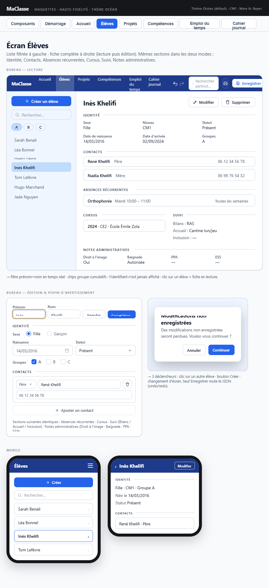

## Maquette

**Cohérence globale** : liste NOM Prénom triée à gauche, bouton CRÉER en haut, fiche en mode lecture avec MODIFIER + SUPPRIMER, sections identité/contacts/absences/cursus éditables inline (sections Notes administratives structurées et Informations utiles ajoutées par le plan 24, postérieures à la maquette), popin d'avertissement "modifications non enregistrées" — tout correspond.

---

## Layout général

Deux colonnes côte à côte :
- **Colonne gauche** : navigation dans la liste des élèves
- **Colonne droite** : détail / formulaire (vide à l'ouverture de l'écran)

---

## Colonne gauche

### Bouton CRÉER

- Positionné en haut, au-dessus du filtre textuel
- En mode formulaire non enregistré : affiche la **popin d'avertissement** avant de vider le formulaire et d'ouvrir un formulaire vide

### Filtre textuel

- Champ `mc-champ-recherche`
- Déclenchement **à la frappe** (temps réel)
- Filtre sur prénom + nom

### Chips de groupe

- Une chip `mc-chip-filtre` par groupe défini dans `referentiels.groupes` (tous les groupes, pas seulement ceux représentés)
- Sélection/désélection filtre la liste en combinaison avec le filtre textuel
- Plusieurs chips sélectionnables simultanément

### Liste des élèves

- Affiche au format **NOM Prénom** (nom en majuscules)
- Triée par **nom de famille** ascendant
- Au clic sur un élève :
  - Si aucun formulaire non enregistré ouvert → affiche la fiche en lecture seule dans la colonne droite + mémorise l'élève dans `ContexteService.eleveSelectionne`
  - Si formulaire non enregistré ouvert → affiche la **popin d'avertissement**

---

## Colonne droite — Onglets

Dès qu'un élève est sélectionné ou qu'un formulaire de création est ouvert, la colonne droite affiche une barre d'onglets `mc-onglets` (« Sections de l'élève ») :

| Onglet | Contenu |
|---|---|
| **Fiche administrative** (`ongletFicheAdministrative`) | Bandeau, sections de la fiche et bouton IMPRIMER décrits ci-dessous, en lecture ou en formulaire |
| **Bilans** (`ongletBilans`) | Bilans de l'élève par sous-domaine de compétences (voir [Onglet Bilans](#onglet-bilans)) |

- La fiche administrative est l'onglet par défaut. L'onglet choisi est **conservé** au changement d'élève.
- En **création** d'un élève, l'onglet Bilans est désactivé et la fiche administrative est affichée.
- Changer d'onglet pendant une saisie non enregistrée affiche la **popin d'avertissement**.
- Navigation clavier : ←/→, Début/Fin, Entrée/Espace (voir [`mc-onglets`](../composants-partages.md#mc-onglets)).

## Fiche administrative — Bandeau supérieur

Contient :

### Mode lecture seule

| Élément | Détail |
|---|---|
| Prénom + Nom | Affiché en titre |
| Bouton **MODIFIER** | Bascule en mode formulaire |
| Bouton **SUPPRIMER** | Composant `mc-bouton-destruction` : affiche ANNULER + CONFIRMER au premier clic |

### Mode formulaire (création ou modification)

| Élément | Détail |
|---|---|
| Champ Prénom | `mc-input` éditable directement dans le bandeau |
| Champ Nom | `mc-input` éditable directement dans le bandeau |
| Bouton **ANNULER** | Revient en lecture seule sans modifier le JSON ; si création, vide la colonne droite |
| Bouton **ENREGISTRER** | Soumet la commande à `DonneesService` ; bascule en lecture seule |

---

## Fiche administrative — Sections

Même organisation en lecture et en modification. Chaque section est séparée par un séparateur léger et un titre.

### Section Identité

| Champ | Mode lecture | Mode formulaire |
|---|---|---|
| Sexe | Valeur texte | `mc-radio-group` (M / F) |
| Date de naissance | Date formatée | `mc-input` type date |
| Date d'arrivée | Date formatée | `mc-input` type date |
| Niveau | Valeur texte | `mc-input` texte |
| Groupes | Liste des groupes | Chips sélectionnables/désélectionnables (un chip par groupe du référentiel) |
| Statut | Libellé du statut | `mc-select` (valeurs issues de `referentiels.statutsEleve`) |
| Bilans externes | Texte libre | `mc-textarea` (`champFormBilansExternes`) |
| Accueil | Texte libre | `mc-textarea` |
| Inclusion | Texte libre | `mc-textarea` |

> L'identifiant (`id`) n'est jamais affiché.

### Section Contacts

- **Lecture** : chaque contact affiché sur **une ligne résumée** (ex. "René Martinot — Père — 06 12 34 56 78")
- **Formulaire** : chaque contact est éditable inline avec ses champs (type, nom, email, téléphone, adresse postale)
- Bouton **AJOUTER** : crée un nouveau contact vide en bas de la liste
- Chaque contact dispose d'un bouton **SUPPRIMER** (`mc-bouton-destruction`)

### Section Absences récurrentes

- **Lecture** : chaque absence sur **une ligne résumée** (ex. "Orthophonie — Mardi 10h00–11h00 — Toutes les semaines")
- **Formulaire** : chaque absence éditable inline (libellé, jour, heure début, heure fin, parité semaine)
- **Plage horaire obligatoire** : heure de début et heure de fin requises (astérisque), fin **strictement postérieure** au début. Message `role="alert"` sous l'absence (`erreurAbsRec{i}`, relié aux deux champs horaires par `aria-describedby`) :
  - *« L'heure de fin doit être postérieure à l'heure de début. »* dès que les deux heures sont saisies et incohérentes (égales ou inversées)
  - *« L'heure de début et l'heure de fin sont obligatoires. »* quand une heure manque, une fois l'un des deux champs horaires modifié ou quitté (pas sur une absence tout juste ajoutée)
  - ENREGISTRER de la fiche est désactivé tant qu'une absence est invalide
  - Les absences invalides des fichiers antérieurs sont corrigées au chargement (migration `2026.09.6`, voir [éléments techniques](../elements-techniques.md#gestion-des-versions-du-json))
- Bouton **AJOUTER** : crée une nouvelle absence vide
- Chaque absence dispose d'un bouton **SUPPRIMER** (`mc-bouton-destruction`)

### Section Cursus

- **Lecture** : chaque année sur **une ligne résumée** (ex. "2024 — CE2 — École Émile Zola")
- **Formulaire** : chaque année éditable inline (année, niveau, établissement, accompagnement)
- Bouton **AJOUTER** : crée une nouvelle entrée de cursus vide
- Chaque entrée dispose d'un bouton **SUPPRIMER** (`mc-bouton-destruction`)

### Section Absences ponctuelles

- **Lecture** : chaque absence sur **une ligne résumée** (ex. "09/06/2026 — Maladie")
- **Formulaire** : chaque absence éditable inline (date + justification)

| Champ | Mode lecture | Mode formulaire |
|---|---|---|
| Date | Date formatée (ex. "09/06/2026") | `mc-input` type date |
| Justification | Texte libre | `mc-textarea` |

- Bouton **AJOUTER** : crée une nouvelle absence ponctuelle vide
- Chaque absence dispose d'un bouton **SUPPRIMER** (`mc-bouton-destruction`)

> Ces absences sont utilisées dans le cahier journal pour désactiver le chip d'un élève dans `mc-eleves-concernes` si cet élève est absent le jour de la séance.

### Section Notes administratives

| Champ | Mode lecture | Mode formulaire |
|---|---|---|
| Droit à l'image | Autorisation (voir ci-dessous) | Autorisation (voir ci-dessous) |
| Autorisation baignade | Autorisation | Autorisation |
| Autorisation de sortie régulière | Autorisation | Autorisation |
| Autres (PPA) | Texte libre | `mc-textarea` |
| ESS | Texte libre | `mc-textarea` |

**Autorisation** (`Autorisation`) : une réponse et une précision.
- **Formulaire** : un `fieldset` par autorisation, dont la légende est le nom de l'autorisation. Il contient à gauche un `mc-radio-group` « Réponse » (**Accepté / Refusé / Sans réponse**) et à droite un `mc-input` « Précision » d'une ligne. Les deux s'empilent sur un écran étroit.
  - **Aucune option n'est cochée par défaut** : la réponse vaut `null` et elle est **non renseignée**, ce qui est différent de « Sans réponse » (la famille n'a pas répondu).
  - Le groupe radio est effaçable (`effacable`) : le bouton **EFFACER** remet la réponse à « non renseignée ».
  - IDs : `champFormDroitImage`, `champFormBaignade`, `champFormSortieReguliere` (groupes radio), suffixés `Precision` pour le champ de précision.
- **Lecture** : « Accepté — *précision* ». La réponse s'affiche seule si la précision est vide, et la précision seule si la réponse n'est pas renseignée. Une autorisation sans réponse ni précision n'est pas affichée.

La section n'est affichée en lecture que si au moins une autorisation, PPA ou ESS est renseigné.

### Section Informations utiles

Dernière section de la fiche.

| Champ | Mode lecture | Mode formulaire |
|---|---|---|
| Port de lunettes | « Port de lunettes » si coché | Case à cocher native (`champFormPortLunettes`, `mc-champ mc-champ--checkbox`) |
| Notification AESH | « Notification AESH » si coché | Case à cocher native (`champFormNotificationAesh`) |
| Latéralité | « Latéralité : Gaucher » si renseignée | `mc-radio-group` effaçable **Gaucher / Droitier** (`champFormLateralite`), sans valeur par défaut |

En lecture, les informations sont affichées sous forme de liste (cases cochées, puis latéralité). La section est masquée si aucune case n'est cochée et que la latéralité n'est pas renseignée.

---

## Bouton IMPRIMER

- Positionné dans la colonne droite (bandeau ou bas de fiche)
- Déclenche l'impression via le navigateur (`window.print()`)
- **La colonne gauche n'est pas imprimée** (masquée via `@media print`)
- Uniquement disponible en mode lecture seule

---

## Onglet Bilans

Composant `fe-onglet-bilans`. Les bilans de l'élève sont regroupés par **sous-domaine**, compétence de niveau 3 de l'arbre (modèle : [bilans d'un élève](../modeles-donnees.md#bilans-dun-élève), service : [`BilanService`](../services.md#bilanservice)).

### Bandeau

- Titre `h2` : NOM Prénom de l'élève
- Bouton **IMPRIMER LES BILANS** (`btnImprimerBilans`), inactif sans bilan : imprime l'onglet, tous les bilans dépliés, sans cadre d'ajout ni boutons (`@media print`)

### Cadre « Ajouter un sous-domaine »

- `mc-selecteur-competences` en sélection unique, limité au **niveau 3** des domaines actifs, libellé `Domaine > Niveau 2 > Sous-domaine` (champ `rechercheCompetencesSousDomaine`)
- Bouton **AJOUTER** (`btnAjouterSousDomaine`), inactif sans sous-domaine choisi ou pendant l'édition d'un bilan
- AJOUTER ouvre un **nouveau bilan en édition** à la fin du sous-domaine (le cadre du sous-domaine est créé s'il n'existe pas) : sans titre, focus sur le titre. C'est le seul point d'entrée pour créer un bilan, y compris un 2e bilan d'un sous-domaine déjà présent
- Le nouveau bilan n'est **enregistré qu'à VALIDER** ; ANNULER le fait disparaître (avec son cadre s'il était seul), sans entrée UNDO

### Cadre de sous-domaine

- Titre `h3` : libellé complet du sous-domaine (son identifiant s'il n'est plus dans les domaines actifs)
- Boutons **TOUT DÉPLIER** / **TOUT REPLIER** (`btnToutDeplier_<id>`, `btnToutReplier_<id>`)
- Liste des bilans dans l'ordre enregistré ; le cadre disparaît avec son dernier bilan

### Bilan en lecture (`fe-bilan`)

Zone repliable, **repliée par défaut** (dépliée après VALIDER).

| Élément | Détail |
|---|---|
| Bouton de bascule (`btnBasculerBilan_<id>`, `h4`) | Date et titre (« (sans titre) » par défaut), `aria-expanded`, `aria-controls="corpsBilan_<id>"` |
| **MODIFIER** | Passe le bilan en édition ; reçoit le focus au retour d'édition |
| **DUPLIQUER** | Copie du bilan, **datée du jour**, ajoutée à la fin du sous-domaine (1 entrée UNDO) |
| **MONTER** / **DESCENDRE** | Échange avec le bilan voisin, effet immédiat (1 entrée UNDO) ; désactivés aux extrémités |
| **SUPPRIMER** | `mc-bouton-destruction [petit]="true"` |

Corps : trois cadres **Bilans**, **Besoins spécifiques**, **Moyens** (HTML, « — » si vide) sur une ligne en écran large et empilés sous 900 px ; puis le tableau Compétence / Évaluation / Commentaire **sans colonne d'actions**. La compétence est affichée relativement au sous-domaine (niveaux 4 et suivants), l'évaluation par son badge (`mc-badge-statut`) et son libellé.

Toutes les actions sont désactivées pendant l'édition d'un bilan : **un seul bilan est en édition à la fois**.

### Bilan en édition (`fe-bilan-formulaire`, Reactive Forms)

`fieldset` dont la légende porte le champ **Titre** (obligatoire). La date **n'est pas saisissable** : c'est celle du jour du dernier clic sur VALIDER.

- VALIDER et ANNULER sont alignés à droite

- **VALIDER** (inactif tant que le formulaire est invalide) enregistre le bilan (1 entrée UNDO) ; **ANNULER** abandonne la saisie
- Messages `role="alert"` : titre obligatoire (une fois le champ modifié ou quitté), évaluation sans compétence, compétence évaluée deux fois
- Trois `mc-editeur-riche` **Bilans**, **Besoins spécifiques**, **Moyens**, sur une ligne en écran large, empilés sous 900 px
- Tableau des évaluations, lignes directement éditables :

| Colonne | Contrôle |
|---|---|
| Compétence | `mc-selecteur-competences` limité aux **feuilles du sous-domaine**, ouvert au clic ou à ↓, libellé masqué « Compétence de la ligne N » ; une compétence déjà évaluée reste proposée, le doublon est signalé et bloque VALIDER |
| Évaluation | `<select>` des statuts d'acquisition du paramétrage (« glyphe libellé »), option vide = non renseignée |
| Commentaire | `<textarea>` simple |
| Actions | En-tête : **AJOUTER** (nouvelle ligne, focus sur sa compétence) ; ligne : **SUPPRIMER** |

### Focus et cohérence

- Après VALIDER ou ANNULER d'un bilan enregistré : focus sur son bouton MODIFIER
- Après ANNULER d'un nouveau bilan : focus sur le champ du cadre d'ajout
- Après SUPPRIMER : focus sur le bouton de bascule du bilan suivant (ou précédent) du sous-domaine, sinon sur le champ du cadre d'ajout
- Si le bilan modifié disparaît des données pendant la saisie (ANNULER de l'entête), l'édition se ferme ; un nouveau bilan, non enregistré, est conservé

### Garde

Un bilan en édition déclenche la popin d'avertissement au changement d'élève, d'onglet ou d'écran. CONFIRMER abandonne la saisie ; un changement d'élève replie aussi les bilans.

---

## Popin d'avertissement (formulaire non enregistré)

Déclenchée par un formulaire de fiche administrative ou un bilan en cours d'édition, dans quatre cas :
- Clic sur un autre élève dans la liste
- Clic sur le bouton CRÉER
- Changement d'onglet
- Navigation vers un autre écran

Contenu :
- Message : *"Des modifications non enregistrées seront perdues. Voulez-vous continuer ?"*
- Bouton **ANNULER** : ferme la popin, reste sur le formulaire
- Bouton **CONFIRMER** : abandonne les saisies et exécute l'action demandée

---

## Aucun champ obligatoire

La validation ne bloque pas l'enregistrement. `EleveService` ne lève pas d'erreur sur des champs vides.
